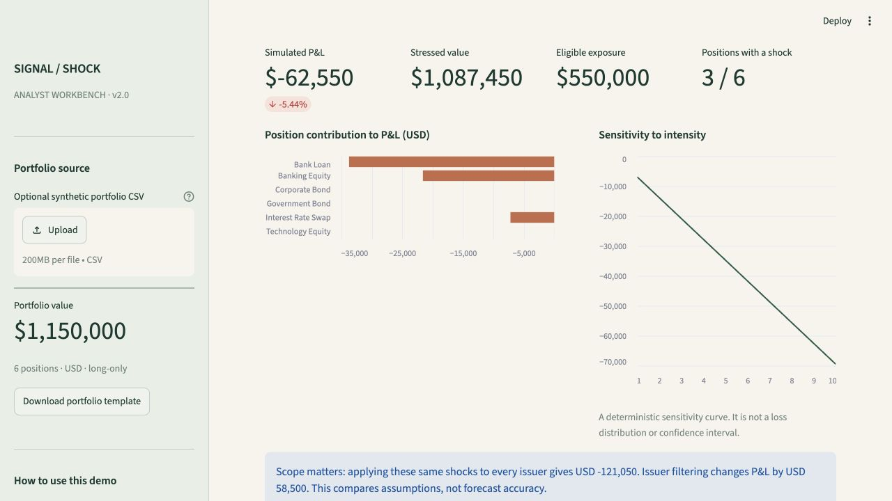
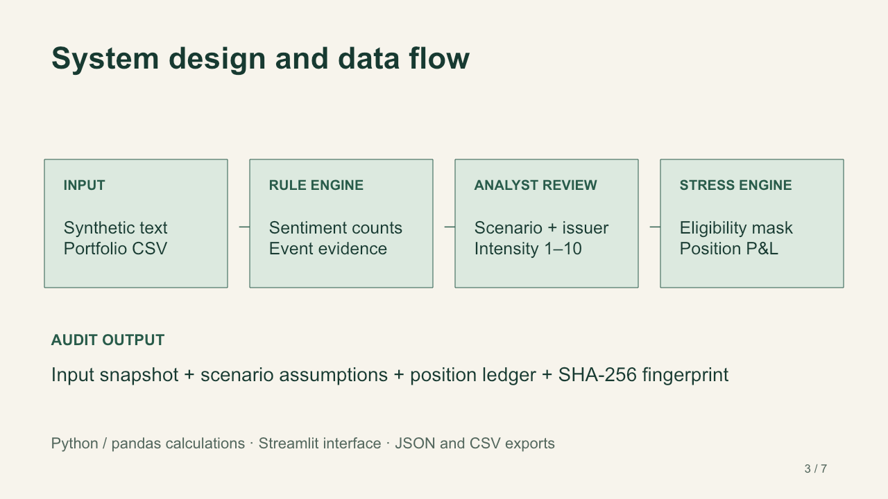

# Signal-to-Shock — S&P Global & CRISIL Campus Hackathon 2026

**Candidate Name:** Devanshi Gupta

**College Email ID:** devanshi034bteceai24@igdtuw.ac.in

**College / Campus:** Indira Gandhi Delhi Technical University for Women (IGDTUW)

**Demo Video Link:** [Watch Demo on YouTube (Unlisted)](https://youtu.be/kTi4sYZG4mY)

**Slide Deck Link:** [Seven-slide PDF](docs/presentation.pdf) · [Editable PowerPoint](docs/presentation.pptx)

[](https://github.com/Devanshi83/igdtuw-devanshi-gupta-hackathon/actions/workflows/tests.yml)

## 1. Project Overview / Problem Statement & Approach

Financial headlines describe events; portfolio decisions require a second step: identifying which issuer and instruments are exposed. A bank default should not automatically shock an unrelated technology company. Signal-to-Shock makes that mapping visible and reproducible for an analyst reviewing financial news or social text.

The prototype extracts sentiment and event evidence with transparent keyword rules. An analyst selects the scenario, target issuer and intensity, then runs an illustrative stress test over a synthetic portfolio. The workbench shows position-level P&L, exposure, sensitivity across intensities and alternative scenarios. Ambiguous headlines, possible negation and unsupported events require explicit review. A downloadable report includes the inputs, scenario definition, rule evidence, calculation outputs and a SHA-256 fingerprint.

The intended use is **event triage and what-if discussion**. No model has been trained. The application does not ingest live news, estimate event probabilities or predict market losses. The separate public-data experiments evaluate sentiment and describe selected historical returns; neither validates the assumed portfolio shocks.



## 2. Architecture & Tech Stack



- **Streamlit:** interactive analyst interface, synthetic CSV upload, charts and downloads.
- **Python, pandas, NumPy:** deterministic scenario calculations and validation.
- **scikit-learn:** sentiment evaluation metrics, optional for running the dashboard.
- **pytest + Streamlit AppTest:** calculation, input-validation and UI regression tests.
- **Optional research tools:** Hugging Face datasets and yfinance, separated from runtime dependencies.

| Module | Responsibility |
|---|---|
| `src/nlp/analyzer.py` | Keyword sentiment, event evidence, ambiguity/negation review flags |
| `src/risk/stress.py` | Validated issuer/systemic shocks and position-level P&L |
| `src/reporting/report.py` | Self-contained audit report, scenario comparison, intensity sensitivity |
| `app.py` | Analyst workbench, evidence and methodology views |
| `scripts/reproduce.py` | Offline demo and historical-window reproduction |

```text
sentiment = (positive keyword count - negative keyword count) / total matched count
position P&L = market value × base asset-type shock × intensity / 10 × issuer eligibility
stressed value = market value + position P&L
```

Sentiment is zero if no sentiment keywords match. Category selection uses the first configured match, exposes all matches, and flags ambiguity. Intensity is a heuristic/user sensitivity setting, not confidence or probability. Issuers are selected by the analyst, not extracted from text. See [methodology](docs/methodology.md).

## 3. Dataset Used

All demo inputs are in [`data/`](data/). See [sources and assumptions](data/README.md) and [checksum manifest](data/manifest.json).

- **Synthetic:** six USD positions totaling **$1,150,000**, six news examples, two social posts and six illustrative scenario definitions. No client data or real holdings.
- **Public historical inputs:** a small cached Yahoo Finance/yfinance price sample in `data/market_data/price_cache.csv`, retained from the earlier research run. Reproduction uses the cache and makes no network request.
- **Public sentiment evaluation:** Financial PhraseBank (`sentences_75agree`, 3,453 sentences), Malo et al., CC BY-NC-SA 3.0. The repository includes aggregate metrics and acquisition/evaluation instructions. Licensed raw sentence outputs are excluded from Git and are not needed to run the prototype. Research data retains its source terms; the code MIT license does not relicense third-party data.

## 4. Quickstart & Installation

**Runtime:** Python 3.12. Fresh installation and tests verified on macOS arm64. GitHub Actions separately checks Ubuntu with Python 3.12. Internet access is needed for installation; the app and offline reproduction then run without API keys or downloads.

```bash
git clone https://github.com/Devanshi83/igdtuw-devanshi-gupta-hackathon.git
cd igdtuw-devanshi-gupta-hackathon
python3.12 -m venv .venv
source .venv/bin/activate
python -m pip install -r requirements.txt
python -m streamlit run app.py
```

On Windows, use `py -3.12 -m venv .venv` and `.venv\Scripts\activate` for the environment steps. Open the localhost address printed by Streamlit. No database or credentials are needed.

**Judge's two-minute path:** choose **NEWS-002**, leave **Credit Event / Example Bank Ltd / intensity 9**, then click **Run portfolio stress test**. Expect **−$62,550**, **3/6** shocked positions and **$1,087,450** after stress. Inspect the ledger, expand the alternative scenarios, and download the JSON audit. NEWS-005 demonstrates the negation review gate; NEWS-003 demonstrates systemic exposure.

```bash
# Tests and offline evidence
python -m pip install -r requirements-dev.txt
python -m pytest -q
python scripts/reproduce.py
python scripts/check_submission.py
python -m pip check

# Optional research evaluation (separate, network-enabled environment)
python -m pip install -r requirements-research.txt
python scripts/evaluation/evaluate_sentiment.py
# Or use legally obtained local labelled input:
# python scripts/evaluation/evaluate_sentiment.py --input-csv /path/to/labelled.csv
```

The local labelled CSV schema is `text,true_label`, with negative/neutral/positive labels. See [evaluation notes](docs/real_data_evaluation.md) for reproducibility limits and sources.

## 5. Key Results & Domain Impact

### A traceable scenario, compared with a naive scope assumption

| Bank-credit scenario, intensity 9 | Result |
|---|---:|
| Synthetic portfolio before stress | $1,150,000 |
| Eligible bank exposure | $550,000 |
| Simulated P&L with issuer filtering | −$62,550 (−5.44%) |
| Positions receiving non-zero shocks | 3 of 6 |
| Same shocks applied to every issuer | −$121,050 |
| Difference due to scope | $58,500 |

This demonstrates correct application of the chosen scope, **not measured loss avoidance or forecast accuracy**. The [committed audit report](results/demo/bank_credit_audit.json) reproduces each position. A risk analyst can inspect assumptions, change intensity and share a replayable result instead of interpreting a bare sentiment score. No real productivity gain has been measured.

### Public-data sentiment benchmark

| Method | Accuracy | Macro F1 |
|---|---:|---:|
| Always-neutral comparator | 62.15% | 0.2555 |
| Current keyword sentiment rules | 67.33% | 0.4319 |

Negative recall is **9.52%**. This baseline misses most negative examples and requires analyst judgment. Metrics were regenerated on 19 October 2026 from retained labelled inputs without label-driven tuning. One prediction differs from the older saved report (67.30%, 0.4314), so the current source fingerprint and figures are recorded in [metrics.json](results/real_data/metrics.json). [Full methodology and per-class results](docs/real_data_evaluation.md).

### Historical context

| Selected event window | Proxy | T−1 to T+5 return | SPY return |
|---|---|---:|---:|
| SVB bank-run period, 9 Mar 2023 | KRE | −19.91% | −0.70% |
| Credit Suisse crisis period, 15 Mar 2023 | XLF | −2.77% | +0.48% |
| UK mini-budget, 23 Sep 2022 | EWU | −5.52% | −4.55% |

These are selected observations, not causal estimates. XLF represents broad US financials, not Credit Suisse equity. SPY is a broad comparator, not a matched causal control. The script rejects incomplete T+5 windows. [Sources, window definitions and limitations](docs/market_data_analysis.md).

## 6. Limitations, Integrity & Next Steps

The portfolio is long-only, USD and synthetic. Bonds, loans and swaps use simplified asset-type market-value shocks; the engine has no duration, spread sensitivity, DV01, margin, liquidity or contagion model. Negation detection only flags a possible issue. The generic `Other` scenario is an explicit analyst what-if and requires review when no event is recognized. Empty text cannot trigger a run. Missing/unknown asset types are rejected. Zero P&L does not establish absence of risk.

Next experiments: compare a contextual NLP model on a frozen holdout, calibrate shocks using a broader time-separated event sample, and introduce instrument-specific bond/swap sensitivities. No improvement is claimed before measurement.

This is an individual submission. AI assistance supported code, tests, documentation and presentation preparation. The candidate is responsible for understanding and explaining the implementation and assumptions. No confidential S&P Global or CRISIL data is used.

## 7. Submission & Project Materials

- **Demo Video:** [YouTube Video Walkthrough (Unlisted)](https://youtu.be/kTi4sYZG4mY)
- **Slide Deck:** [Seven-slide PDF](docs/presentation.pdf) · [Editable PowerPoint](docs/presentation.pptx)
- **Architecture & System Design:** [`docs/architecture.png`](docs/architecture.png)
- **Methodology & Assumptions:** [Methodology Guide](docs/methodology.md)
- **Empirical Validation Record:** [Validation Report](docs/validation.md)
- **Financial PhraseBank Benchmark:** [Sentiment Evaluation](docs/real_data_evaluation.md)
- **Historical Event Analysis:** [Market Data Analysis](docs/market_data_analysis.md)

